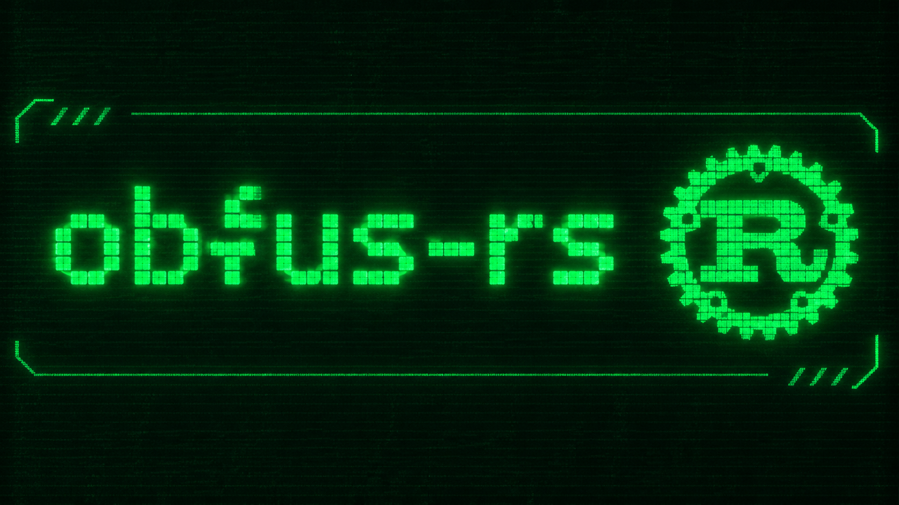

# obfus-rs

<p align="center">
  
</p>

Compile-time string and integer obfuscation library for Rust.

> **Note:** This project is under active development. More features and improvements are planned.

## Features

- Compile-time string obfuscation
- Runtime string deobfuscation
- Compile-time integer obfuscation
- Support for all standard signed and unsigned integer types
- XOR-based obfuscation
- SplitMix64-based keystream and mask generation
- Seed generation based on source location
- UTF-8 support
- Heap-allocation-free implementation
- `no_std` support
- Memory zeroization using `zeroize`
- No unsafe code

## Installation

Add `obfus` to your `Cargo.toml`:

```toml
[dependencies]
obfus = "0.1.4"
```

## Example

```rust
use obfus::{obfstr, obfval};

fn main() {
    let message = obfstr!("Hello, World!");
    let number = obfval!(12345u32);

    assert_eq!(message, "Hello, World!");
    assert_eq!(number.get(), 12345u32);
}
```

## Usage

### String obfuscation

Use `obfstr!` to obfuscate string literals at compile time.

The encrypted data is decrypted at runtime when the expression is evaluated.

```rust
use obfus::obfstr;

fn main() {
    let message = obfstr!("Sensitive string");

    println!("{message}");
}
```

### Integer obfuscation

Use `obfval!` to obfuscate integer literals at compile time.

Supported types:

- Unsigned: `u8`, `u16`, `u32`, `u64`, `u128`, `usize`
- Signed: `i8`, `i16`, `i32`, `i64`, `i128`, `isize`

Access the original value using `.get()`.

```rust
use obfus::obfval;

fn main() {
    let value = obfval!(12345u32);
    let negative = obfval!(-123i32);

    assert_eq!(value.get(), 12345u32);
    assert_eq!(negative.get(), -123i32);
}
```

### Memory zeroization

Decrypted string buffers and obfuscated integer storage are zeroized when their respective values are dropped.

The library uses [`zeroize`](https://crates.io/crates/zeroize) to clear owned storage.

This does not guarantee removal of every copy of a value from memory, registers, compiler-generated temporaries, or values copied by the caller.

## Testing

Run the test suite with Cargo:

```bash
cargo test
```

## Dependencies

- [`zeroize`](https://crates.io/crates/zeroize) — securely zeroizes owned sensitive data.

## Disclaimer

This library is intended to make static analysis and extraction of embedded values more difficult.

It is not a cryptographic library and does not provide cryptographic security. The obfuscated values can still be recovered through runtime analysis, debugging, or reverse engineering.

`obfus-rs` does not guarantee that strings or integer values cannot be recovered at runtime.